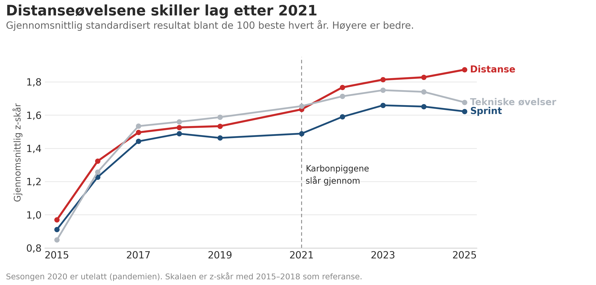
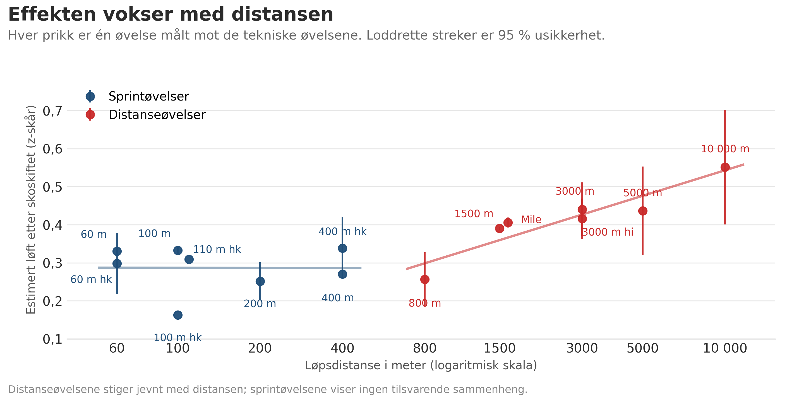

\artikkelopener{Hva har superskoene gjort med resultatlistene?}{Amerikanske college-årslister viser at distanseøvelsene løftet seg etter 2021 — og at effekten vokser med distansen}{Atle G. Guttormsen og Simen Guttormsen}{Fagnytt 2026}{Sko, teknologi og prestasjon}{Alle vet at superskoene har endret langdistanseløpingen. Men har de endret resultatlistene på banen? Og i så fall: i hvilke øvelser, og hvor mye? Vi har brukt 45 925 årsbesteprestasjoner fra amerikansk collegeidrett til å svare. Kort fortalt: distanseøvelsene løftet seg tydelig etter 2021, effekten er større jo lengre løpet er, og den finnes ikke i sprint eller i tekniske øvelser. Det betyr at kvalifiseringsgrenser, rekorder og rangering på mellom- og langdistanse ikke lenger kan leses uten å ta hensyn til skoene.}

\lettrine[lines=3]{D}{a} Nike Vaporfly kom på markedet i 2017, endret den maratonløpingen nesten over natten. Laboratoriestudier viste at skoen senket energikostnaden ved å løpe med rundt fire prosent (Hoogkamer mfl., 2018; Barnes og Kilding, 2019). Konkurranse\-data bekreftet det: antallet menn som løp under 2:08 på maraton steg med omtrent 24 per år (Bjørkelø mfl., 2024), og resultatlistene på vei ble skrevet om i alle distanser (Bermon mfl., 2021; Muñiz-Pardos mfl., 2021; Rodrigo-Carranza mfl., 2021).

For baneløpingen tok det lenger tid. Distansepigger med lignende teknologi — lett, elastisk skum og stive karbonplater — ble allment tilgjengelig rundt 2019–2020. Sprintpigger med nye materialer kom noe senere; de tydeligste sprintutslagene i verdens hundre beste årsresultater kommer først i 2021–2022 (Willwacher mfl., 2024). Men på banen er bildet mer sammensatt enn på veien. Sprintere har kort bakkekontakttid og er avhengige av eksplosiv kraft; der hjelper ikke en sko som sparer energi over tusenvis av steg. Mellom- og langdistanse bruker derimot kroppens energisystemer over lang tid, og da bør besparelsen akkumulere seg med hvert eneste steg. Nettopp fordi bakkekontakttid og fysiologiske krav varierer så kraftig fra sprint til maraton, er gevinsten av superpigger vanskelig å tallfeste i laboratoriet (Healey mfl., 2022).

::: {.sitat}
«Jo lengre løpet er, desto mer hjelper skoene. Det er nøyaktig det vi finner.»
:::

## Hvorfor collegeidrett?

Amerikansk collegeidrett har én avgjørende fordel for den som vil studere skoeffekten: bredden. Hvert år rapporteres hundretusener av resultater i alle øvelser, for begge kjønn, i et system der distanseløpere, sprintere, hoppere og kastere konkurrerer i de samme sesongene og på de samme stevnene. Det gjør det mulig å sammenligne øvelsesgrupper direkte: hvis superskoene har løftet distanseøvelsene, men ikke sprint og tekniske øvelser, bør forskjellen synes i resultatlistene.

Vi brukte de 100 beste årsbestenoteringene i hver øvelse og klasse, hvert år fra 2015 til 2025 — til sammen 45 925 prestasjoner fra 46 øvelses-kjønns-lister. Fordi utøvere går igjen fra sesong til sesong, kan vi følge den *samme* utøveren over tid og kontrollere for erfaring og kalenderår. Det skiller denne analysen fra studier som bare sammenligner topplistene fra ett år til det neste uten å vite hvem som er byttet ut.

## Hva vi sammenlignet

Vi delte øvelsene i tre familier:

- **Distanse** (800 meter til 10 000 meter): her skulle superskoene ha størst effekt.
- **Sprint** (60 meter til 400 meter hekk): her er bakkekontakttiden kort og energisparingsmekanismen mindre relevant.
- **Tekniske øvelser** (hopp og kast): her har distansepiggene ingen direkte rolle.

Fordi øvelsene har forskjellige enheter — sekunder, meter, poeng — regnet vi om alle resultater til en felles skala: et standardisert mål der høyere betyr bedre, uansett øvelse.

::: {.faktaboks}
- **Datagrunnlag:** 45 925 topp-100 årsbesteprestasjoner fra amerikansk collegeidrett (NCAA), sesongen 2015–2025, hentet fra Track and Field Results Reporting System. Datasettet omfatter 46 øvelses-kjønns-lister og er hentet fra en bredere populasjon på 50 604 utøvere.
- **Øvelser:** Distanse (800 m til 10 000 m), sprint (60 m til 400 m hekk) og tekniske øvelser (hopp og kast). Hver øvelse og klasse er behandlet separat.
- **Metode:** Alle resultater er omregnet til en felles standardisert skala (z-skårer basert på fordelingen før 2021). Hovedmodellen følger den samme utøveren over tid med faste effekter for utøver, erfaring og kalenderår. Distanseøvelsene sammenlignes med sprint og tekniske øvelser før og etter 2021, da karbonpigger ble allment synlige i collegeidretten.
- **Robusthet:** Resultatet holder når vi varierer listens dybde (topp-200, topp-300, fullt utvalg), fjerner de siste sesongene, begrenser utvalget til utøvere med flere øvelser, og winsoriserer ytterverdier. Dose-respons-testen og tidsmønsteret støtter den øvelsesspesifikke tolkningen.
- **Publisering:** Manuskriptet er innsendt til *Journal of Sports Analytics* (2026).
:::

## Distanseøvelsene løftet seg

I vår foretrukne modell, der vi følger den samme utøveren og kontrollerer for erfaring og kalenderår, forbedret distanseøvelsene seg med 0,064 standardavvik sammenlignet med de tekniske øvelsene etter 2021. Det er et beskjedent tall for et enkeltløp, men det flytter rangeringen i tette årslister der mange utøvere ligger tett.

Bruker vi sprint som sammenligningsgruppe i stedet — altså bare løpsøvelser mot hverandre — blir distanseeffekten enda tydeligere: 0,118 standardavvik. Det distanseøvelsene har lagt på seg etter 2021, har altså ikke sprintøvelsene lagt på seg.

Tidsmessig passer det som en hanske. Figur 1 viser at distanseøvelsene og de andre fulgte hverandre tett frem til 2021. Deretter skiller distanseøvelsene lag oppover, mens sprint og tekniske øvelser fortsetter omtrent som før.

## Effekten vokser med distansen

Den sterkeste testen er om løftets størrelse henger sammen med hvor langt utøverne løper. Hvis det er superskoene som driver endringen, bør effekten være minst på 800 meter og størst på 10 000 meter — fordi energibesparelsen akkumulerer seg med hvert steg.

Det er nøyaktig det vi finner (figur 2). De øvelsesspesifikke estimatene stiger jevnt med logaritmen av løpsdistansen. Estimatet for 10 000 meter er omtrent dobbelt så stort som for 800 meter. Sprintøvelsene viser ingen tilsvarende sammenheng: der ligger estimatene på omtrent samme nivå fra 60 til 400 meter.

Dette mønsteret er vanskelig å forklare med andre faktorer. En generell bedring i trening, konkurransetilbud eller restitusjon etter pandemien ville truffet alle løpsøvelser mer likt. At effekten følger distansen, peker mot en mekanisme som gir mer jo lengre man løper — altså skoenes energiretursystem.

::: {.sitat}
«En trener som vurderer egne utøveres fremgang på 3000 meter etter 2020, bør trekke fra noe for skoene.»
:::

## Også tersklene har flyttet seg

Det er ikke bare gjennomsnittet som har endret seg. Vi modellerte hvor ofte utøvere krysset faste historiske terskler — for eksempel antall menn under 3:42 på 1500 meter. Raten mer enn doblet seg etter 2021. I 2018 klarte 23 menn det; i 2025 klarte 118 det.

Og forbedringen gjelder ikke bare toppen av listen. Nummer 50 på 1500-meterlisten forbedret seg med 4,8 sekunder fra 2018 til 2025, nummer 100 med 4,3 sekunder, mens nummer én forbedret seg med 2,0 sekunder. I prosent er forbedringene omtrent like gjennom hele listen. Det tyder på at superskoene har løftet hele bredden av distanselistene, ikke bare skapt noen få ekstraordinære prestasjoner på toppen.

::: {.raad}
**1. Trekk fra for skoene på mellom- og langdistanse etter 2020.** Resultatlistene på 800 meter og lengre har flyttet seg oppover. En «pers» i 2025 er ikke direkte sammenlignbar med en i 2019, og forskjellen vokser med distansen.

**2. Vær forsiktig med historiske kvalifiseringsgrenser.** Når dobbelt så mange krysser en terskel, representerer den ikke lenger det samme nivået. Krav som ble satt før superskoene, bør tolkes med forbehold.

**3. Sprint og tekniske øvelser er uberørt.** Superskoeffekten gjelder distanseøvelsene. En 100-meter- eller høyderesultat fra 2025 kan leses uten korreksjon for sko.

**4. Se på mønsteret, ikke bare tallet.** Én rask tid kan skyldes dagsform. Men når hele distanselisten løfter seg, effekten vokser med distansen, og sprintlisten ikke gjør det samme — da er det noe systematisk som har endret seg.

**5. Husk at estimatene måler sko-æraen, ikke enkeltskomodeller.** Vi vet ikke nøyaktig hvilke sko utøverne hadde på seg. Det vi måler, er forskjellen mellom perioden før og etter at karbonpiggene ble allment tilgjengelige. For trenere er det likevel den relevante størrelsen: det er resultatlistene du leser, ikke skomerket.
:::

## Hva betyr dette for trenere?

Resultatene gjelder direkte for alle som leser årslister, setter mål etter historiske grenser eller vurderer om en utøver har gått frem. En kvalifiseringsgrense som ble satt før 2020, betyr ikke det samme i dag. Når dobbelt så mange krysser den, representerer den ikke lenger den samme prosentandelen av utøvermassen. Det gjelder kvalifiseringskrav til mesterskap, collegestipend, rekordlister og utviklingsmodeller som bruker historiske merker som referansepunkt.

Studien er gjort på amerikansk collegeidrett, men mekanismen er universell: superskoene virker likt overalt der utøvere løper langt i karbon\-pigger. Norske trenere som vurderer fremgang på mellom- og langdistanse etter 2020, bør ha skoene med i regnestykket.

## Metoden kan brukes på mer enn sko

Tilnærmingen vi bruker — å følge utøvere over tid, sammenligne øvelsesfamilier og se om effekten følger et forventet mønster — er ikke begrenset til skoer. Den kan brukes på alle utstyrsskifter som sprer seg gradvis og ikke lar seg observere direkte i historiske datasett. Kombinasjonen av fem steg — felles resultatskala, øvelsesfamilier som kontroller, tidsserie, dose-respons-test og terskeldiagnostikk — gir et rammeverk for å avgjøre om et prestasjonsskifte er teknologidrevet eller generelt.\sluttmerke

::: {.forfatter}
**Atle G. Guttormsen** er professor ved Handelshøyskolen ved NMBU og står bak friidrettsresultater.no. **Simen Guttormsen** er tidligere NCAA-stavhopper og medforfatter. Artikkelen er basert på manuskriptet «Super shoes and track performance: Evidence from collegiate leaderboards» (Guttormsen og Guttormsen, 2026).
:::

### Referanser

::: {.referanser}
Barnes, K. R. og Kilding, A. E. (2019). A randomized crossover study investigating the running economy of highly-trained male and female distance runners in marathon racing shoes versus track spikes. *Sports Medicine*, 49(2), 331–342.

Bermon, S., Garrandes, F., Szabo, A., Berkovics, I. og Adami, P. E. (2021). Effect of advanced shoe technology on the evolution of road race times in male and female elite runners. *Frontiers in Sports and Active Living*, 3, 653173.

Bjørkelø, A., Savitz, R. og Waggoner, B. (2024). Super shoes: How super are they? *Journal of Sports Analytics*. doi: 10.3233/JSA-240703.

Guttormsen, A. G. og Guttormsen, S. (2026). Super shoes and track performance: Evidence from collegiate leaderboards. Manuskript innsendt til *Journal of Sports Analytics*.

Healey, L. A., Bertschy, M., Kipp, S. og Hoogkamer, W. (2022). Can we quantify the benefits of «super spikes» in track running? *Sports Medicine*, 52(6), 1211–1218.

Hoogkamer, W., Kipp, S., Frank, J. H., Farina, E. M., Luo, G. og Kram, R. (2018). A comparison of the energetic cost of running in marathon racing shoes. *Sports Medicine*, 48(4), 1009–1019.

Muñiz-Pardos, B., Sutehall, S., Angeloudis, K., Guppy, F. M., Bosch, A. og Pitsiladis, Y. P. (2021). Recent improvements in marathon run times are likely technological, not physiological. *Sports Medicine*, 51(3), 371–378.

Rodrigo-Carranza, V., González-Mohíno, F., Santos del Cerro, J., Santos-Concejero, J. og González-Ravé, J. M. (2021). Influence of advanced shoe technology on the top 100 annual performances in men's marathon from 2015 to 2019. *Scientific Reports*, 11, 22458.

Willwacher, S., Mai, P., Helwig, J., Hipper, M., Utku, B. og Robbin, J. (2024). Does advanced footwear technology improve track and road racing performance? An explorative analysis based on the 100 best yearly performances in the world between 2010 and 2022. *Sports Medicine — Open*, 10(1), 14.
:::
